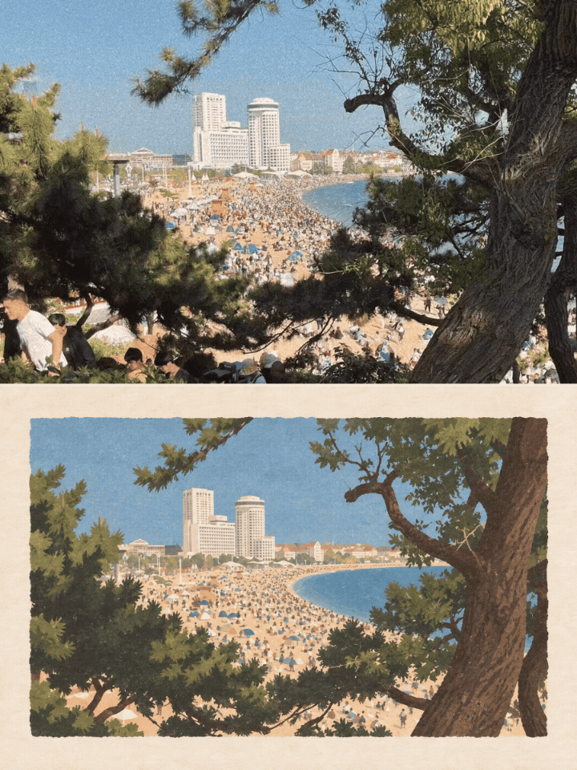
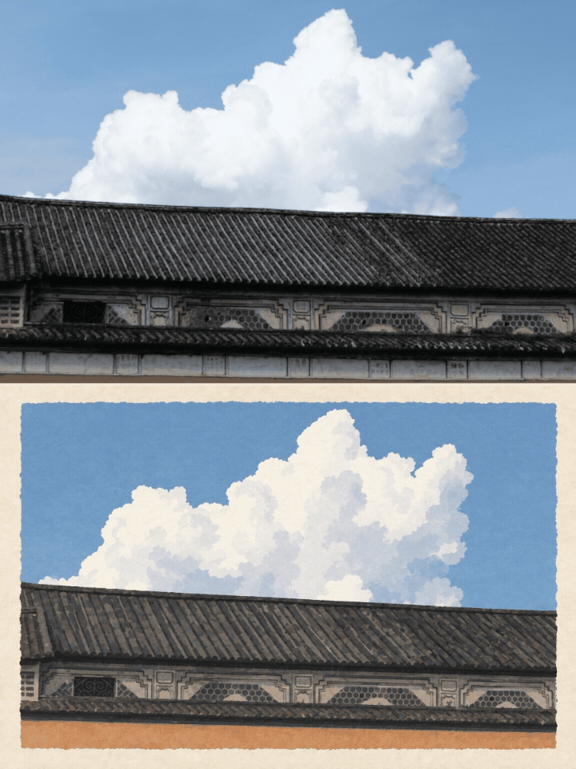
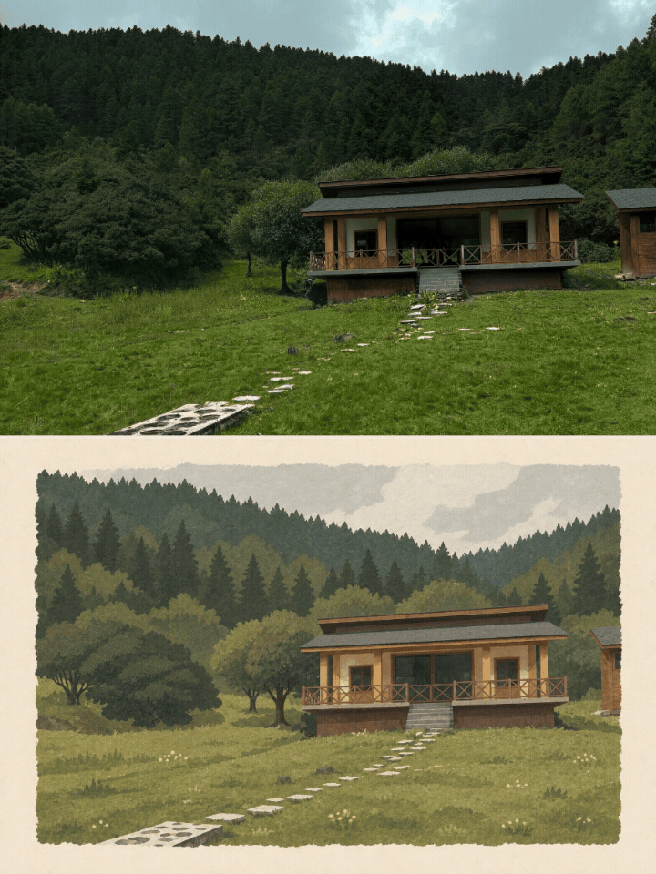

# 一景微动 · Scene Paper Motion

**scene-paper-motion** 是一个将生活场景转成“上方照片＋下方纸感插画”并制作局部循环动图的 Agent Skill。主题模式先生成摄影画面；照片模式保留用户原照的构图关系。作品默认交付 PNG 对照图和 GIF，支持时也可附高清 MP4。

## 使用

在支持 Agent Skills 的宿主中安装本仓库的 `scene-paper-motion/` Skill，然后调用：

- `$scene-paper-motion 雨后的江南小巷`
- `$scene-paper-motion 夏日海边，白云漂移`
- `$scene-paper-motion 用这张照片生成同系列，动图快一点`

明确只要静态图时，Skill 会停止在 PNG。

## 动态效果示例

  
  
  

## 仓库内容

- `scene-paper-motion/SKILL.md`：输入模式、视觉约束、动态锚点选择和交付流程
- `scene-paper-motion/references/`：提示词、系列示例与渲染说明
- `scene-paper-motion/assets/`：风格参考图、静态示例和 GIF 示例
- `scene-paper-motion/scripts/render.cjs`：按 plan.json 合成并检查循环动画

动画脚本需要 `@napi-rs/canvas` 和 `sharp`；若环境没有所需依赖，应保留素材并如实说明，不能把静态图称为动图。完整说明见 [SKILL.md](scene-paper-motion/SKILL.md)。
